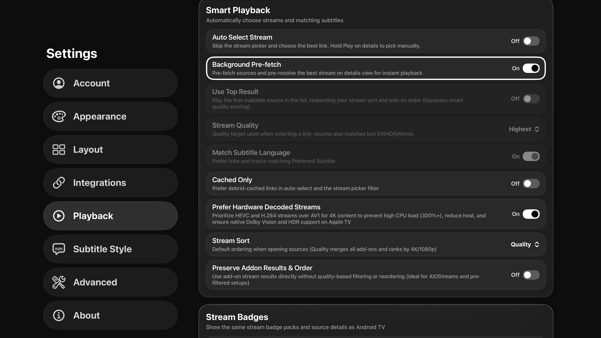
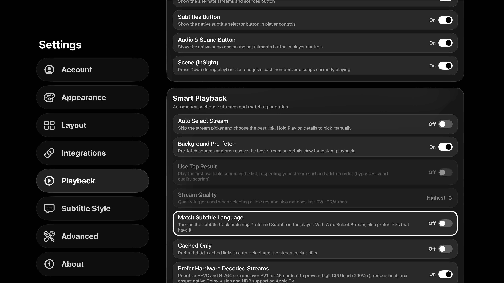
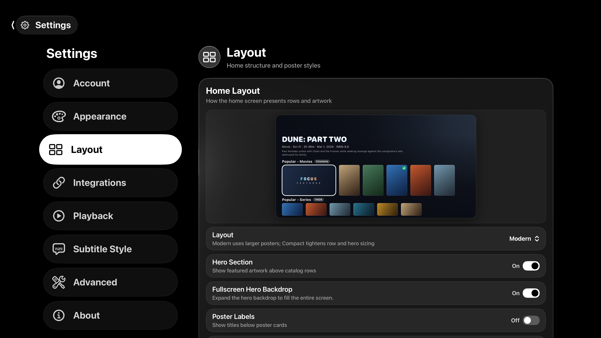

# First PR batch validation

Final integration: `b2f59f6ff8b064943ce38dc1f6feb05417a25d23`, based on latest main `35704ed75`. All ten original PR heads are preserved, including updated PR 240 at `f0caaf23`. A focused follow-up adds a stable identifier to existing native poster buttons and uses it in the navigation smoke test.

Xcode 27.0; isolated Apple TV 4K (3rd generation), tvOS 27.0 simulator.

- Final focused unit suites: **246 passed, 0 failed**.
- Final UI launch and Home-to-Details remote navigation: **2 passed, 0 failed**.
- Initial UI smoke also verified that content-type toggle and pull-to-refresh report their **2 expected skips**.
- The new UI scheme generates and compiles. The earlier unavailable-touch-API blocker is resolved.

The full legacy UI suite was not run; many flows still require explicit account/catalog fixtures and reliable selectors. Physical-device playback, memory pressure, and delayed Jellyfin authentication were not exercised.

## PR 243

Before: Match Subtitle Language is grayed out with Auto Select Stream off. After: the control receives remote focus and can be switched off/on with Auto Select Stream still off.

## PR 251

Before/after Home Layout previews use the shared card modifier with AMOLED Mode and Pure Black Surfaces enabled. Focused and unfocused cards remain legible. Artwork/gradient fills mask much of the underlying surface in this preview; these images do not establish physical-TV power savings or validate every shared-surface call site. Screenshots compare baseline 35704ed75 and candidate6fdfe67; the subsequent testability-only identifier change does not change rendering.

## Results

[Final unit-test summary](unit-final-summary.json)

[Final UI navigation summary](ui-final-summary.json)
